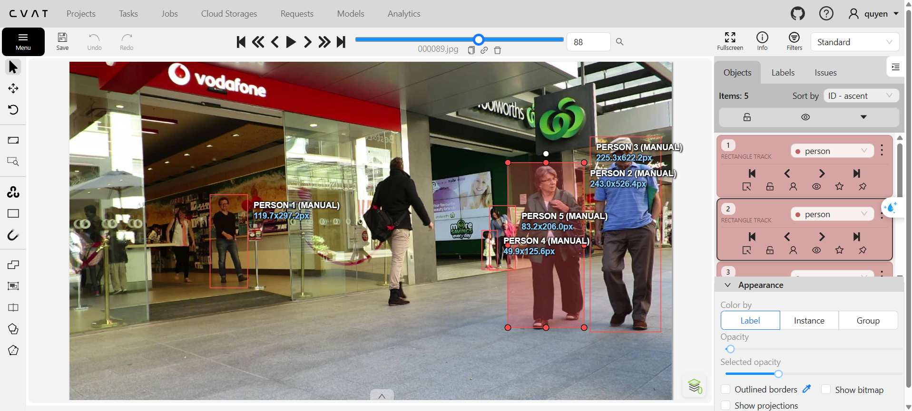
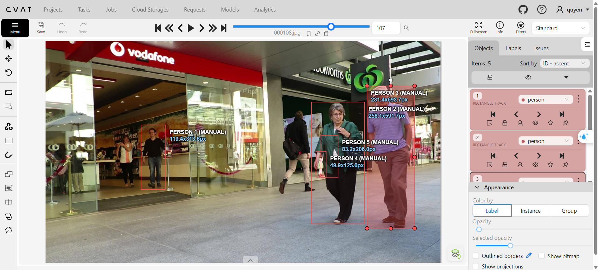
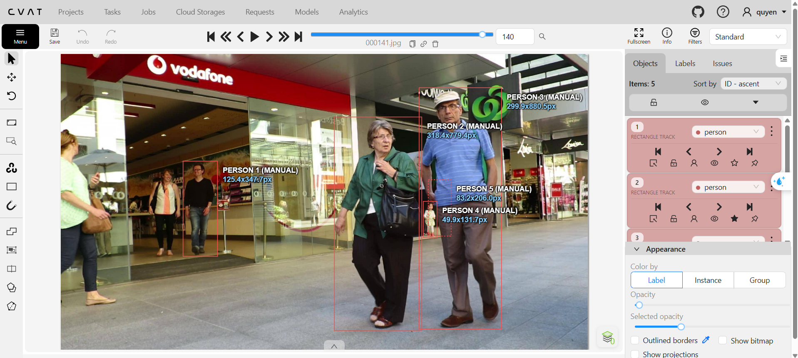

# Báo cáo cá nhân — HoVaTen-MSSV

Đổi tên file theo quy tắc `MSSV_HoTen.md`. Ví dụ: `20241234_NguyenVanAn.md`.

Đoạn video: MOT17-09, 150 frame (frame 1–150), nguồn MOTChallenge, giấy phép CC BY-NC-SA 3.0.

## 0. Thông tin học viên

- Họ tên: Lương Văn Quyến
- MSSV: 2A202603226
- Mã đề (A/B/C): B
- Email: 26ai.quyenlv@vinuni.edu.vn
- Link repository: https://github.com/VanQuyen11/K5-L2-DAY05-LuongVanQuyen-2A202603226-MOTTracking/tree/main
- Giờ bắt đầu: 16h00
- Giờ kết thúc: 18h20

## 1. Xem trước đoạn video (CP0)

Ghi **trước khi vẽ**, mỗi người một dòng.

| Mã | Frame xuất hiện | Frame cuối thấy được | Rẽ / dừng / đổi tốc độ ở frame | Bị che ở frame | Ghi chú |
|---|---|---|---|---|---|
| P1 |0 |149 | |42 | |
| P2 |0 |149 | | | |
| P3 |40 |149 | | | |
| P4 |0 |141 | |128 | |
| P5 |2 |95 | |110 | |

## 2. Keyframe và thời gian (CP1, CP4)

Số keyframe lấy từ kết quả `src/check_submission.py`.

| Mã | Số keyframe | Keyframe ở frame | Số frame có mặt | Keyframe / 100 frame | Thời gian (phút) | Chỗ khó |
|---|---|---|---|---|---|---|
| P1 |15 |0, 10, 20, 30, 40, 50, 60, 70, 80, 90, 100, 110, 120, 130, 149 |150 |10.0 |20 | |
| P2 |16 |0, 10, 20, 30, 40, 50, 60, 70, 80, 90, 100, 110, 120, 130, 140, 149 |150 |10.7 |20 | |
| P3 |12 |40, 50, 60, 70, 80, 90, 100, 110, 120, 130, 140, 149 |110 |10.9 |30| |
| P4 |9 |0, 10, 20, 30, 40, 50, 110, 140, 149 |110 |6.0 |20 | |
| P5 |7 |2, 12, 22, 32, 42, 52, 112 |148 |4.7 |15 | |
| **Tổng** |59 | |708 | | | |

Keyframe / 100 frame của cả bài = tổng keyframe ÷ tổng số frame có mặt × 100 = 8.3

Bạn đặt keyframe nhiều nhất ở người nào? Vì sao (người đó rẽ, dừng, lại gần camera hay bị che)?

track CVAT 1, với 16 keyframe. Track này có mặt đủ 150 frame và được đặt keyframe khoảng 10 frame một lần. File xuất không ghi track này là P nào, cũng không cho biết lý do chuyển động cụ thể như rẽ hay dừng.

## 3. Đoạn bị che (CP2)

Người bị che: `P4`

| Mốc | Frame |
||111:|
| Bắt đầu bị che một phần (bật `occluded`) |106 |
| Mất hẳn (bật `outside`) |111 |
| Hiện lại (tắt `outside`) |137 |
| Thấy rõ trở lại (tắt `occluded`) |140 |

- Thời gian khuất hẳn: 111 frame = 0.86 giây.   ở 30 FPS
- Quyết định: giữ cùng ID 
- Lý do (trả lời 3 câu: khuất bao lâu so với 60 frame, ngoại hình có khớp, chỗ hiện lại có đúng hướng và tốc độ): 
-Khuất 26 frame nhỏ hơn 60 frame.
-Ngoại hình trước/sau: Phù hợp
-Vị trí xuất hiện đúng hướng và tốc độ.

...

Ảnh chụp màn hình:

## 4. Tự review ID (CP3)

Lượt 1 theo người (đi ngược từ frame 149 về 0 trên CVAT), lượt 2 theo cảnh (nhảy 10 frame). Ít nhất 3 dòng; không có lỗi thì ghi một dòng "đã kiểm hai lượt, không lỗi".

Loại lỗi dùng đúng một trong 7 mã: `id_switch`, `fragmentation`, `lost`, `merge`, `false_track`, `drift`, `flag`.

| Frame | Mã người | Loại lỗi | Mô tả một câu | Phát hiện ở lượt | Đã sửa? |
|---:|---|---|---|---|---|
| 111–136 | P4 | `flag`  | Mục 3 ghi P4 mất hẳn từ frame 111 đến 136, nhưng track CVAT ID 3 vẫn có `outside=0` và MOT ID 3 vẫn có box trong toàn đoạn. | 111-136 | Có |
| 96–149 | P5 | `false_track`  | Mục 1 ghi P5 được thấy lần cuối ở frame 95, nhưng track CVAT ID 4 và MOT ID 4 vẫn có box đến frame 149. | 96-149 | Có |
| 142–149 | P4 | `false_track`  | Mục 1 ghi P4 được thấy lần cuối ở frame 141, nhưng track CVAT ID 3 và MOT ID 3 vẫn có box đến frame 149. | 142-149 | Có |

Tổng hợp số lỗi theo loại:

| `id_switch` | `fragmentation` | `lost` | `merge` | `false_track` | `drift` | `flag` |
|---:|---:|---:|---:|---:|---:|---:|
| 0  | 0  | 0  | 0  | 1 | 0  | 1 |

Lỗi nào chỉ lượt 2 (theo cảnh) mới thấy, lượt 1 (theo người) không thấy? Vì sao?

Lỗi flag, frame 120, P4: “Ở lượt 2, tôi thấy P4 đã khuất hẳn nhưng box vẫn hiển thị do chưa bật cờ outside. Tôi bật outside từ frame bắt đầu khuất hẳn và tắt cờ khi P4 hiện lại.”

## 5. File xuất và kết quả tự kiểm (CP4)

| Kiểm tra | Kết quả |
|---|---|
| Tên file MOT 1.1 |'src\exports\LuongVanQuyen_mot.zip' |
| Tên file CVAT for video 1.1 |'src\exports\LuongVanQuyen_cvat_video.zip' |
| Số track ID khác nhau trong `gt/gt.txt` (phải là 5) |5 |
| Frame `outside` không có dòng trong `gt.txt` (đúng / sai) |Đúng |
| Job đã completed trên CVAT máy cá nhân |Đúng |

Dán phần tóm tắt in ra từ `src/check_submission.py`:

Số frame in theo CVAT (bắt đầu từ 0). Trong gt.txt, frame_id = frame CVAT + 1.

=== File MOT 1.1: LuongVanQuyen_mot.zip ===
  Số track ID: 5   |   Tổng số box: 708
  [OK]        Đúng 5 track ID.

  Track | Frame có mặt | Số frame | Đoạn vắng (outside)
      1 |   0–149      |      150 | -
      2 |   0–149      |      150 | -
      3 |   0–149      |      150 | -
      4 |   2–149      |      148 | -
      5 |  40–149      |      110 | -

=== File CVAT for video 1.1: LuongVanQuyen_cvat_video.zip ===

  Track | Nhãn   | Frame thấy | Keyframe | KF/100 frame | Frame occluded | Lần bật outside
      0 | person |        150 |       15 |         10.0 |             10 |               0
              Track 0: keyframe ở frame [0, 10, 20, 30, 40, 50, 60, 70, 80, 90, 100, 110, 120, 130, 149]
      1 | person |        150 |       16 |         10.7 |              0 |               0
              Track 1: keyframe ở frame [0, 10, 20, 30, 40, 50, 60, 70, 80, 90, 100, 110, 120, 130, 140, 149]
      2 | person |        110 |       12 |         10.9 |              0 |               0
              Track 2: keyframe ở frame [40, 50, 60, 70, 80, 90, 100, 110, 120, 130, 140, 149]
      3 | person |        150 |        9 |          6.0 |             31 |               0
              Track 3: keyframe ở frame [0, 10, 20, 30, 40, 50, 110, 140, 149]
      4 | person |        148 |        7 |          4.7 |             38 |               0
              Track 4: keyframe ở frame [2, 12, 22, 32, 42, 52, 112]

  Tổng: 59 keyframe / 708 frame có mặt = 8.3 keyframe / 100 frame
  [OK]        Đọc được 5 track từ annotations.xml.

=== Tóm tắt ===
  Lỗi: 0   |   Cảnh báo: 0
  Đạt. Dán phần tóm tắt này vào báo cáo mục 5.

## 6. Ba câu kết

1. Nếu được gán lại, bạn sẽ đặt keyframe khác ở đâu? Vì sao?

   Tôi sẽ kiểm tra và cân nhắc thêm keyframe giữa 50–110 của P4 và 52–112 của P5. Hai khoảng cách 60 frame này dài; nếu người đổi vị trí hoặc kích thước không đều, box nội suy có thể trôi. Tôi cũng sẽ kiểm tra cờ outside của P1 quanh frame 42.

2. Có chỗ nào bạn không chắc "cùng ID hay ID mới"? Bạn đã quyết định và ghi chú thế nào?

   Đoạn P1 bị che quanh frame 42 là chỗ cần quyết định. Theo hướng dẫn, nếu chỉ khuất khoảng 7 frame và người hiện lại khớp ngoại hình, hướng đi, tốc độ thì giữ cùng ID, vì ngắn hơn ngưỡng 60 frame. File xuất hiện giữ P1 trong một track, nhưng chưa bật outside tại frame 42; cần kiểm tra và sửa cờ nếu P1 đã khuất hẳn.

3. Một lỗi ID trong job của bạn (nếu không còn sót, chọn lỗi đã sửa) có thể làm xe tự lái dự đoán sai chuyển động của người đó như thế nào? Lỗi đó ảnh hưởng MOTA hay IDF1 nhiều hơn?

   Với điểm nghi lỗi flag ở frame 42, box vẫn hiện khi người đã khuất hẳn có thể khiến hệ thống dự đoán người vẫn ở vị trí đó. Nếu xác nhận đây là lỗi, nó chủ yếu tạo false positive, nên tác động trực tiếp đến MOTA. Nếu bạn đã từng sửa một lỗi id_switch thực tế, hãy dùng lỗi ấy cho câu hỏi “lỗi ID”: ID nhảy sang người khác làm quỹ đạo dự đoán nhảy theo và thường ảnh hưởng IDF1 nhiều hơn.

## Bonus (nếu làm)

### B1 — Hai người đi sát

...

### B2 — So cách đặt keyframe

| Cách đặt | Số keyframe | Frame trôi nhất | Ghi chú |
|---|---:|---:|---|
| Đều mỗi 30 frame | | | |
| Theo chỗ đổi hướng | | | |

...

### B3 — So với tracker có sẵn

| Frame | Mã người | Tracker làm gì | Nhãn của bạn | Giải thích (đoán rồi sửa / ghép IoU / box score thấp / ngoại hình) |
|---:|---|---|---|---|
| | | | | |
| | | | | |

## 7. Tài liệu tham khảo và công cụ AI đã dùng

Dữ liệu MOT17-09 từ MOTChallenge (CC BY-NC-SA 3.0). Tài liệu sử dụng: CHECKPOINTS.md, docs/GUIDELINE.md, docs/MOT_FORMAT.md và lab_day05_walkthrough.md trong repo. Công cụ: CVAT để gán nhãn; src/check_submission.py để kiểm tra file xuất; ChatGPT/Codex để giải thích kết quả kiểm tra và góp ý nội dung báo cáo.
